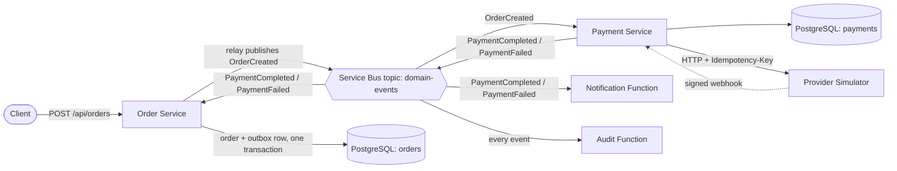

# PayFlow

**Event-driven payment processing platform built with .NET 10, Azure Service Bus, Azure Functions and Kubernetes.**


A customer places an order, a payment is attempted against an external provider, and the order ends up confirmed or
rejected, with every step in between asynchronous. The business logic is intentionally trivial. The interesting part is
making that flow **correct when things fail**: crashes between a database write and a publish, messages delivered twice,
a provider that times out, webhooks that arrive in parallel.

> **Status in one line:** the whole flow runs locally and in CI against real PostgreSQL and the real Service Bus emulator
> (95 automated tests), and ran on AKS in Azure with a passing end-to-end smoke test. The Azure Functions app is built and
> tested but **does not run in Azure yet**. See [Status](#status-and-known-limitations) for exactly what is and is not verified.

## Architecture



Four deployables (Order Service, Payment Service, provider simulator, an Azure Functions app) plus three shared libraries
(`PayFlow.Contracts`, `PayFlow.Messaging`, `PayFlow.ServiceDefaults`). Each service is split into `Domain` / `Application` / `Infrastructure` / `Api`,
owns its own database, and talks to the others only through events. The full picture, sequence diagrams, failure matrix and
data model are in [`docs/architecture.md`](docs/architecture.md); the reasoning is in the [decision records](docs/adr/README.md).

## Event-driven communication

One Service Bus topic carries every domain event, and each consumer has its own filtered subscription with its own
dead-letter queue:

| Subscription | Receives | Why |
|---|---|---|
| `payment-service` | `OrderCreated` | start a payment |
| `order-service` | `PaymentCompleted`, `PaymentFailed` | confirm or reject the order |
| `notification-function` | `PaymentCompleted`, `PaymentFailed` | send the email |
| `audit` | everything | audit trail |

Adding a consumer is a new subscription, not a change to any publisher. Messages carry the event id as `MessageId`
(broker-side duplicate detection), the event type as `Subject` (filters), a correlation id and the W3C trace context.
Details and a trap I hit with the default rule: [ADR 0003](docs/adr/0003-topic-with-filtered-subscriptions.md).

## Payment lifecycle

A payment moves `Pending -> Processing -> Completed | Failed`; an order moves `Pending -> Confirmed | Rejected | Cancelled`.
Every transition is idempotent (applying it twice is a no-op) and impossible transitions are rejected. State diagrams:
[architecture.md](docs/architecture.md#state-machines).

The provider simulator behaves like Stripe or Adyen, and a test token chooses the outcome (table under [Running locally](#running-locally)).

## Reliability and idempotency

At-least-once delivery means "the same message arrives twice" is normal, and for a payment the worst result is charging twice.
Defence is layered, because each layer covers a case the others cannot ([ADR 0002](docs/adr/0002-idempotent-consumers.md)):

| Layer | Protects against |
|---|---|
| Inbox table keyed by `MessageId` | the same message handled twice |
| Unique index on `Payments.OrderId` | the same business event arriving with a *different* `MessageId` |
| `Idempotency-Key` on the provider call | a crash after the provider took the money, before the result was saved |
| Optimistic concurrency (`xmin`) | two writers overwriting each other, e.g. parallel duplicate webhooks ([ADR 0005](docs/adr/0005-optimistic-concurrency.md)) |

On the HTTP side, calls to the provider have per-attempt timeouts, retries with backoff and a circuit breaker
(`Microsoft.Extensions.Http.Resilience`). If the provider stays down, the broker redelivers up to five times and the last attempt
fails the payment, so an order is never left stuck.

### Why the Outbox Pattern?

Saving an order and publishing `OrderCreated` cannot be one transaction. Insert first and a crash means the order exists and
nobody pays for it; publish first and a payment starts for an order that does not exist. So the event is written to an
`OutboxMessages` table **in the same transaction as the order**, and a background relay publishes it afterwards, claiming rows with
`FOR UPDATE SKIP LOCKED` so several replicas can run together ([ADR 0001](docs/adr/0001-transactional-outbox.md)).

### Dead-letter queue

A message is dead-lettered after 5 failed deliveries (`MaxDeliveryCountExceeded`), or immediately when it can never succeed
(`PermanentFailure`, for example a malformed payload), so it is not retried pointlessly. `tools/PayFlow.DlqTool` can `peek`, `resubmit`,
`purge` and `send-poison`:

```bash
export SERVICEBUS_CONNECTION_STRING="Endpoint=sb://localhost;SharedAccessKeyName=RootManageSharedAccessKey;SharedAccessKey=SAS_KEY_VALUE;UseDevelopmentEmulator=true;"
dotnet run --project tools/PayFlow.DlqTool -- send-poison              # publish a malformed OrderCreated
dotnet run --project tools/PayFlow.DlqTool -- peek payment-service     # reason, delivery count, body
dotnet run --project tools/PayFlow.DlqTool -- resubmit payment-service # back to the topic, then removed from the DLQ
dotnet run --project tools/PayFlow.DlqTool -- purge payment-service
```

Resubmit keeps the original `MessageId`, so consumers' inbox tables recognise anything they already handled (`--new-id` overrides this
inside the topic's duplicate-detection window).

## Observability

OpenTelemetry traces, metrics and logs from every service. The W3C trace context travels inside each message, and the outbox stores it
next to the event, so one order is **one trace across services**, even though the relay publishes later on another thread
([ADR 0009](docs/adr/0009-trace-context-through-messages.md)):

```
POST /api/orders -> postgresql -> publish -> payment-service process -> POST /payments -> publish -> order-service process
```

This was verified in Application Insights in Azure. Exporters are chosen by configuration: OTLP (Aspire Dashboard locally), Azure Monitor
when `APPLICATIONINSIGHTS_CONNECTION_STRING` is set, or the console (`Telemetry__Console=true`). Custom metrics:
`payflow.outbox.published`, `payflow.outbox.publish_failures`, `payflow.messages.processed` (by outcome: success, abandoned, dead_lettered) and
`payflow.messages.processing_duration`. Every log line carries the correlation id. Health endpoints are split: `/health/live`
(process only) and `/health/ready` (database), and shutdown waits up to 30 s for in-flight handlers.

## Security

No secret is stored in the repository, in the pipeline or in a pod's environment ([ADR 0006](docs/adr/0006-identity-without-secrets.md)):

- Service Bus has **shared access keys disabled**; services use managed identities with only the roles they need.
- Pods use **AKS Workload Identity** (one identity per service); runtime secrets live in **Key Vault** and are mounted by the CSI driver.
- CI signs in to Azure with **OIDC federation**, trusting only this repository's `main` branch.
- Containers run non-root on a chiseled image with a read-only filesystem under the `restricted` pod security standard; images are scanned
  with Trivy in CI. The webhook endpoint verifies an HMAC signature in constant time.

## Infrastructure as code

Terraform (`infra/terraform`, six modules) creates Service Bus, PostgreSQL Flexible Server, Key Vault, Container Registry, Application
Insights, the Function App, the workload identities with their role assignments and, optionally, an AKS cluster (`deploy_aks`, off by
default because it is the expensive part). Kubernetes manifests are in `deploy/kubernetes` (Kustomize), one Dockerfile builds all services.
The runbook, the cost, and the **lessons the first real `apply` taught** are in [`deploy/README.md`](deploy/README.md).

## CI/CD

GitHub Actions: build with warnings as errors, unit, architecture and integration tests (Testcontainers), Terraform `fmt`/`validate`,
manifest checks, image builds with a Trivy scan, and Dependabot. Deployment is a manual workflow that signs in with OIDC, builds and
pushes the images, applies the manifests and ends with a **smoke test that places a real order through the cluster and waits for
`Confirmed`**.

## Running locally

Needs the .NET 10 SDK and Docker. No Azure account.

```bash
cp .env.example .env      # set local-only passwords
docker compose up -d      # PostgreSQL, Service Bus emulator, Azurite, Aspire Dashboard
```

| Component | Address |
|---|---|
| PostgreSQL | `localhost:5432` (databases `orders`, `payments`) |
| Service Bus emulator | `localhost:5672` |
| Aspire Dashboard (traces, logs) | http://localhost:18888 |

Start the services (set `ASPNETCORE_ENVIRONMENT=Development` and `ASPNETCORE_URLS=http://localhost:<port>` for each; in Development they apply
their EF migrations on startup):

```bash
dotnet run --project src/OrderService/Api --launch-profile http   # :5101
dotnet run --project src/PaymentService/Api                       # :5102
dotnet run --project src/PaymentProviderSimulator                 # :5200
```

Create an order and choose the payment outcome with a test token:

```bash
curl -X POST http://localhost:5101/api/orders -H "Content-Type: application/json" \
  -d '{"customerId":"<guid>","amount":149.99,"currency":"EUR","paymentToken":"tok_success"}'
curl http://localhost:5101/api/orders/<orderId>          # Pending, then Confirmed a moment later
curl http://localhost:5102/api/payments/by-order/<orderId>
```

| Token | Provider behaviour | Demonstrates |
|---|---|---|
| `tok_success` | 200 | happy path |
| `tok_declined` / `tok_insufficient` | 402 | business failure, `PaymentFailed` |
| `tok_flaky` | 503 twice, then 200 | HTTP retries with an idempotency key |
| `tok_500` | always 500 | retries, broker redelivery, the last attempt fails the payment |
| `tok_timeout` | hangs 30 s | per-attempt timeout |
| `tok_async` / `tok_async_declined` | 202, result via signed webhook | webhook handling |
| `tok_duplicate_webhook` | 202, same webhook delivered twice | idempotent webhooks |

The functions need [Azure Functions Core Tools](https://learn.microsoft.com/azure/azure-functions/functions-run-local) (Azurite is in the compose file):
`cp src/NotificationFunction/local.settings.json.example src/NotificationFunction/local.settings.json && cd src/NotificationFunction && func start`.

## Tests

```bash
dotnet test PayFlow.slnx               # everything; the integration tests need Docker running
dotnet test tests/ArchitectureTests    # no Docker needed
```

95 tests: 50 unit, 14 architecture (NetArchTest: layers only depend inwards, services never reference each other, events are immutable) and 31
integration tests on real PostgreSQL and the real Service Bus emulator. The integration tests go after the failure modes rather than the
happy path: an atomic outbox, a crash after sending, two relays draining one table, 20 parallel requests with one idempotency key, ten parallel
duplicate webhooks, a hung provider, a poison message, an order cancelled mid-payment. Two of them guard against real bugs found while building this
(an unprotected idempotency-key race, and duplicate events from concurrent webhooks); each fix was verified by removing it and watching the test fail.

## Status and known limitations

| | State |
|---|---|
| Whole flow locally and in CI (real PostgreSQL, real emulator) | verified, 95 tests |
| Deployed to AKS: images built in CI, Workload Identity, Key Vault secrets, cross-region PostgreSQL | verified; the smoke test confirmed an order in about 3 s |
| One trace across services in Application Insights | verified |
| Azure Functions (notification, audit) | built and unit-tested, **not working in Azure**: the Flex Consumption host does not load them, cause unknown ([ADR 0007](docs/adr/0007-functions-on-flex-consumption.md)) |
| Lower telemetry volume after silencing outbox polling | implemented and unit-tested, **volume reduction not yet measured** (the workspace was over its daily cap) |

Things this project deliberately does not do:

- **No refund.** If an order is cancelled while its payment is in flight and the payment then completes, the order stays cancelled but the
  money is not returned. That needs a compensating step ([ADR 0004](docs/adr/0004-choreography-over-orchestration.md)).
- **No orchestrated saga, no inventory step.** The flow is choreography; an inventory failure with a refund would be the natural extension.
- **The `payment-commands` queue is provisioned but unused.** Only events are published.
- **Demo-grade networking:** PostgreSQL is reachable through the "allow Azure services" rule with password authentication (production: private endpoint
  and Entra authentication), one node, no ingress, and the CI identity has broad rights. The table in [`deploy/README.md`](deploy/README.md) lists these and the production answer for each.

## Repository layout

```
src/
  OrderService/ PaymentService/        Domain, Application, Infrastructure, Api per service
  PaymentProviderSimulator/            fake Stripe/Adyen with test tokens
  NotificationFunction/                Azure Functions: notification and audit
  PayFlow.Messaging/                   outbox relay, inbox, consumer, trace propagation
  PayFlow.ServiceDefaults/             OpenTelemetry, health, shutdown
  PayFlow.Contracts/                   events and shared abstractions
tests/                                 unit, architecture, integration
tools/PayFlow.DlqTool/                 dead-letter queue CLI
infra/terraform/  infra/scripts/       Terraform modules; state bootstrap and GitHub OIDC setup
deploy/                                Dockerfile, Kubernetes manifests, runbook
docs/                                  architecture and decision records
.github/workflows/                     CI, deploy, functions deploy, CodeQL (public repos), Dependabot
```
