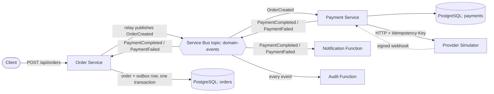
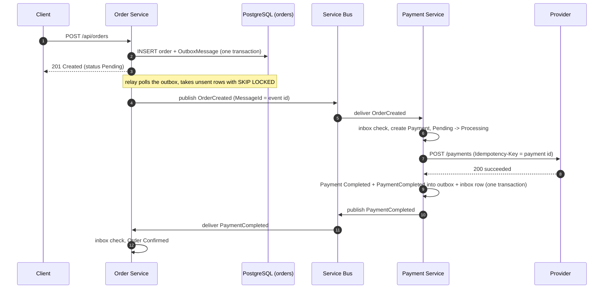
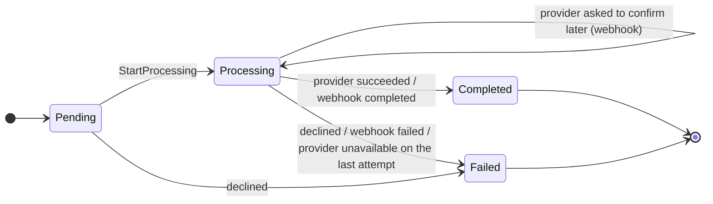
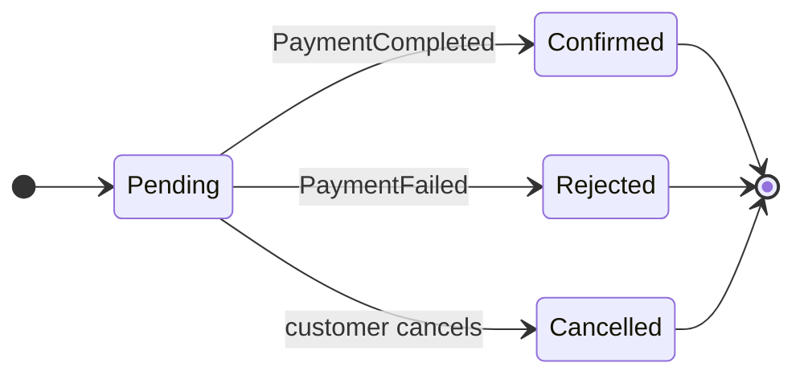
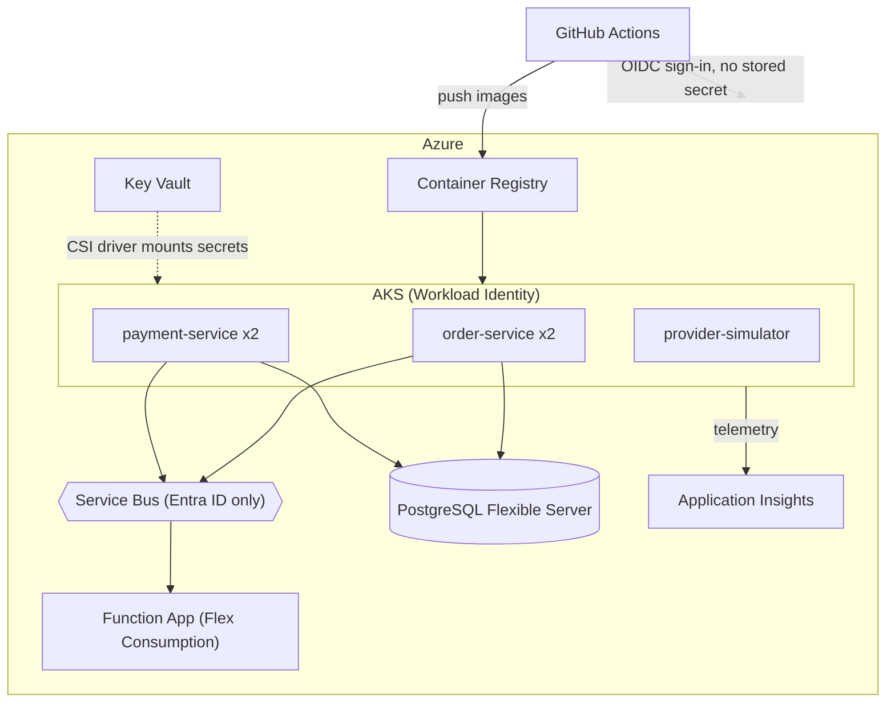

# Architecture

PayFlow is a small payment-processing back end whose difficulty is deliberately in the distributed-systems parts, not in
the business rules: a customer places an order, a payment is attempted against an external provider, and the order ends up
confirmed or rejected. Everything between those steps is asynchronous.

The decisions behind the design are recorded in [`docs/adr`](adr/README.md). This page is the map.

## Components

| Component | Responsibility |
|---|---|
| **Order Service** (ASP.NET Core) | Accepts orders, owns the `Order` aggregate and its status, publishes `OrderCreated`, reacts to payment results. |
| **Payment Service** (ASP.NET Core) | Owns the `Payment` aggregate. Reacts to `OrderCreated`, charges the provider, handles provider webhooks, publishes `PaymentCompleted` / `PaymentFailed`. |
| **Provider Simulator** | Stands in for Stripe/Adyen. A test token in the request chooses the outcome (success, decline, 500, timeout, flaky, asynchronous result through a signed webhook). |
| **Notification / audit functions** (Azure Functions) | React to payment results (email text) and to every event (audit line). |
| **PayFlow.Messaging** (library) | Outbox relay, inbox, subscription consumer, dead-letter handling, trace propagation. |
| **PayFlow.ServiceDefaults** (library) | OpenTelemetry, health endpoints, graceful shutdown, shared by the web services. |
| **PayFlow.DlqTool** (CLI) | Inspect, resubmit and purge dead-lettered messages; publish a poison message. |

Each service is split into `Domain`, `Application`, `Infrastructure` and `Api`, with dependencies pointing inwards. Architecture
tests enforce this and the isolation between services.

## The system



## Messaging topology

One topic carries all domain events. Each consumer has its own filtered subscription and its own dead-letter queue
([ADR 0003](adr/0003-topic-with-filtered-subscriptions.md)).

| Subscription | Receives | Handler |
|---|---|---|
| `payment-service` | `OrderCreated` | `OrderCreatedProcessor` -> `ProcessPaymentHandler` |
| `order-service` | `PaymentCompleted`, `PaymentFailed` | `PaymentResultProcessor` -> `ApplyPaymentResultHandler` |
| `notification-function` | `PaymentCompleted`, `PaymentFailed` | `PaymentNotificationFunction` |
| `audit` | everything | `AuditFunction` |

Every message carries: `MessageId` (= the event id, used by the broker's duplicate detection), `Subject` (= the event type, used
by subscription filters), `CorrelationId`, and the W3C `traceparent` in its application properties.

## Happy path



In the cluster this whole path takes about three seconds.

## State machines





All transitions are idempotent: applying the same one twice is a no-op, and an impossible one is rejected.

## What happens when something fails

| Failure | What happens | Covered by |
|---|---|---|
| Order Service crashes after the order commits, before publishing | The outbox row is already saved; the relay publishes it later. | integration (atomicity), relay tests |
| Relay sends, then crashes before marking the row sent | The row is published again with the **same** `MessageId`; the broker drops the duplicate inside its window, and consumers are idempotent anyway. | integration |
| Two relay replicas run at once | `SKIP LOCKED` keeps them apart; every row is published exactly once. | integration (100 rows, two relays) |
| Payment Service crashes mid-charge | The message is redelivered. The existing payment is reused and the provider sees the same idempotency key, so the money is taken once. | unit, integration |
| Same `OrderCreated` arrives twice (same or different `MessageId`) | One payment, one charge, one result event. | integration, end to end |
| Provider returns 5xx or hangs | HTTP retries with backoff (3 attempts, 3 s each), then the broker redelivers (up to 5 times); on the last delivery the payment is failed and `PaymentFailed` is published instead of leaving the order stuck. | end to end (`tok_500`), provider client tests |
| Provider sends the same webhook twice, even in parallel | One `PaymentCompleted`; the loser of a concurrent race gets `409` and the provider's retry sees the final state. | integration, end to end |
| A message can never be processed (malformed) | Dead-lettered immediately with reason `PermanentFailure`, no pointless retries. | end to end |
| Customer cancels while payment is in flight | Order stays `Cancelled` when the payment result arrives. **The payment is not refunded** (known gap, [ADR 0004](adr/0004-choreography-over-orchestration.md)). | end to end |
| Database unavailable | `/health/ready` fails and the pod leaves the Service; `/health/live` stays green so the pod is not restarted for a dependency outage. | verified on a hardened container |

## Data

Each service owns its own database (`orders`, `payments`) on one PostgreSQL server; nothing reads another service's tables.
Besides its domain table each database has the technical tables from `PayFlow.Messaging`:

- `OutboxMessages`: events waiting to be published (id, type, JSON payload, correlation id, trace context, attempts, last error).
- `ProcessedMessages`: the inbox, `(MessageId, Consumer)` as the key.

`Order` and `Payment` use PostgreSQL's `xmin` as an optimistic concurrency token ([ADR 0005](adr/0005-optimistic-concurrency.md)).

## Observability

OpenTelemetry traces, metrics and logs from every service; the W3C trace context travels with each message
([ADR 0009](adr/0009-trace-context-through-messages.md)), so one order is one trace:

```
POST /api/orders -> postgresql -> publish -> payment-service process -> POST /payments -> publish -> order-service process
```

Custom metrics: `payflow.outbox.published`, `payflow.outbox.publish_failures`, `payflow.messages.processed` (by subscription and
outcome: success, abandoned, dead_lettered) and `payflow.messages.processing_duration`. Every log line carries the correlation id.

## Deployment



Terraform creates everything except the state storage account (`infra/scripts/bootstrap-state.ps1`) and the GitHub identity
(`infra/scripts/setup-github-oidc.ps1`). AKS is optional (`deploy_aks`) because it is by far the most expensive part. The function
app is shown as the intended design: it does not run yet ([ADR 0007](adr/0007-functions-on-flex-consumption.md)).
